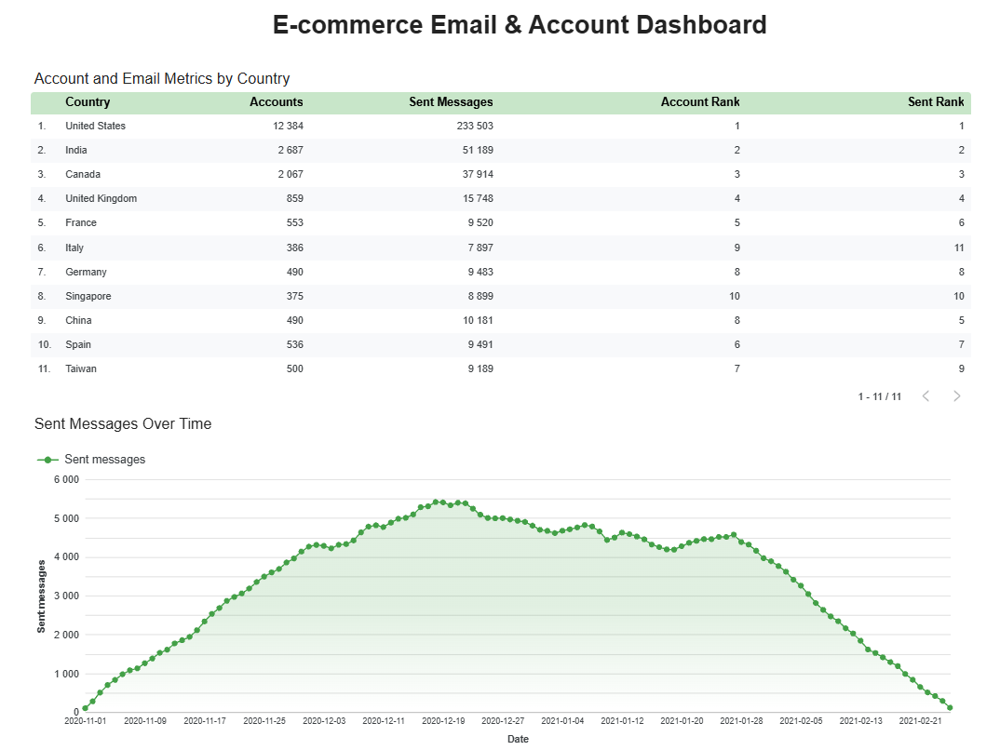
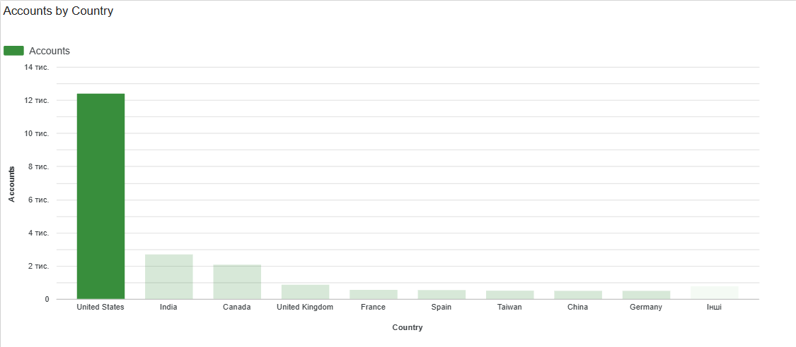
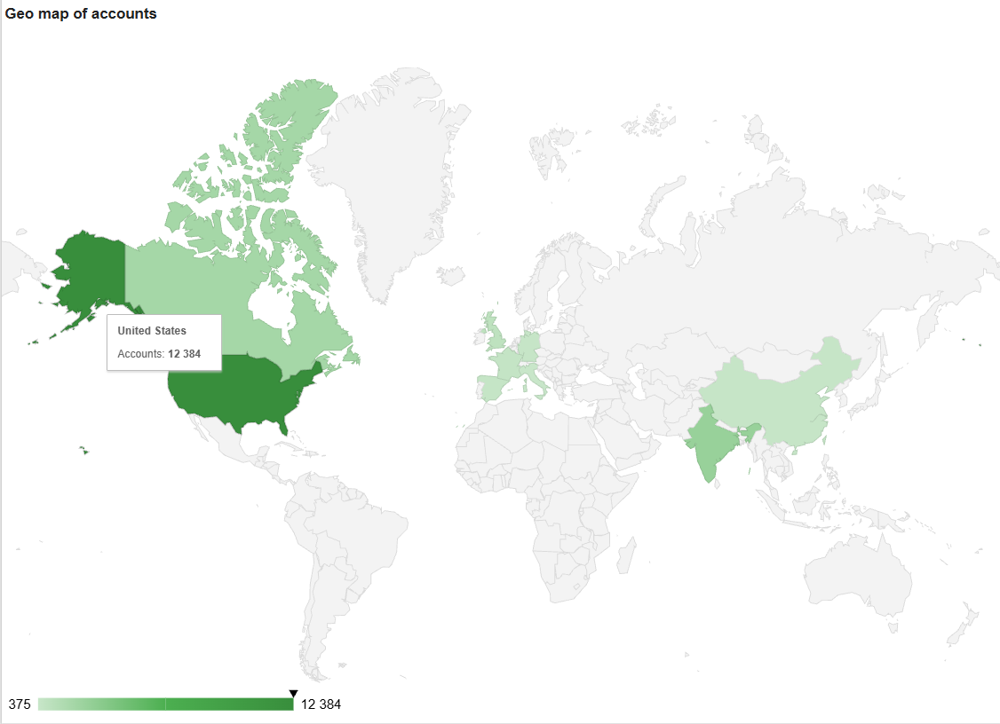
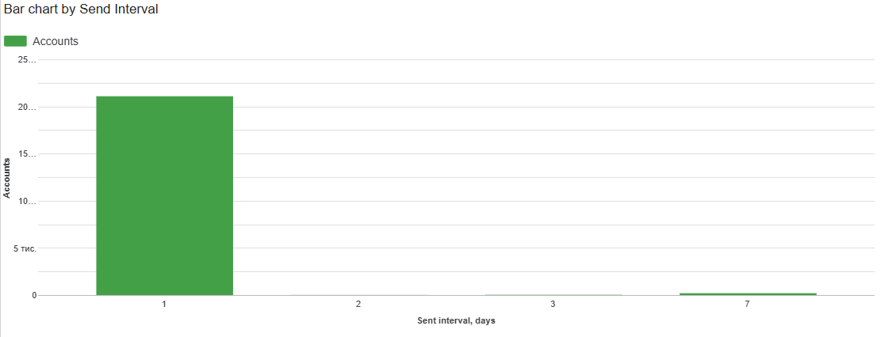
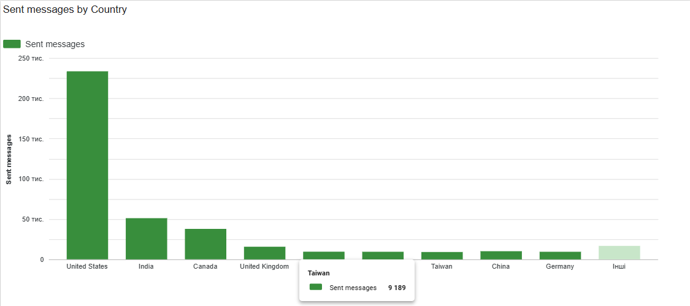

# E-commerce Email & Account Analysis

## Project Overview

This project focuses on analyzing account creation and email engagement using SQL in Google BigQuery and visualizing the results in Looker Studio.

The analysis includes:
- Account distribution across countries.
- Email metrics: sent, opened, and clicked emails.
- Account segmentation by email send interval, verification status, and unsubscribe status.
- Country ranking by total account count and sent email count.
- Email sending trends over time.

## Tools Used

- SQL (Google BigQuery)
- Looker Studio

## SQL Code

[View the full SQL query](analysis.sql)

## Data Visualization & Key Findings

### 1. E-commerce Email & Account Dashboard

The United States ranks first in both account count and sent messages, with 12,384 accounts and 233,503 sent emails.

Daily email volume peaked in mid-December 2020.

### 2. Accounts by Country

The United States has the largest number of accounts, followed by India and Canada.

### 3. Geographic Distribution of Accounts

The geographic map highlights the concentration of accounts across different countries.

### 4. Accounts by Email Send Interval

The one-day email send interval is by far the most common setting among accounts.

### 5. Sent Messages by Country

The United States leads in email sending volume, followed by India and Canada.

## Key Findings

- The United States leads in both account count (12,384) and sent emails (233,503).
- India and Canada rank second and third in both metrics.
- A one-day email send interval is the most common among accounts.
- Email sending volume peaked in December 2020 and gradually declined towards the end of the analysed period.
